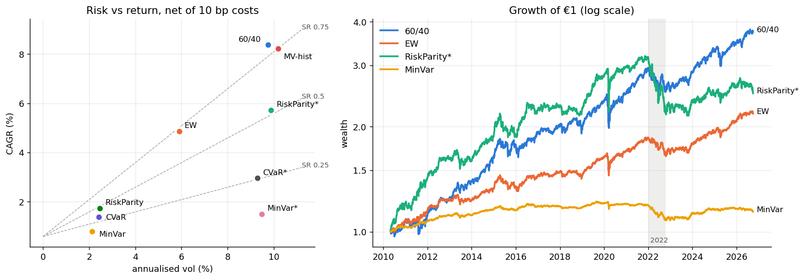
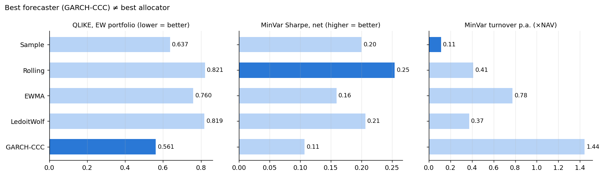
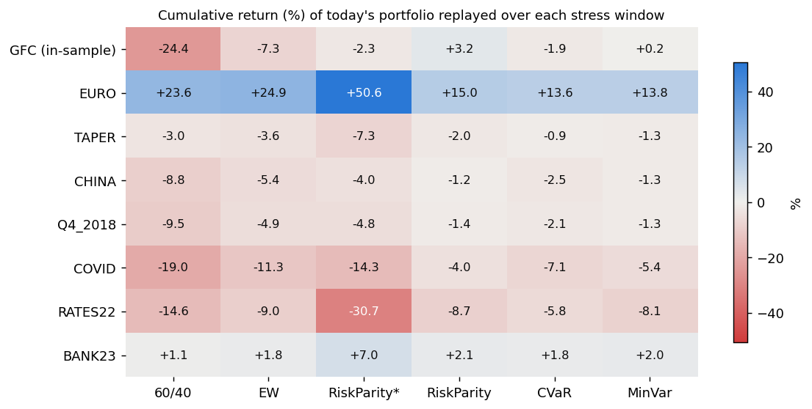

# 02 — Global Multi-Asset Portfolio & Risk Management

EUR-based multi-asset portfolio (US / Euro Area / Japan) comparing covariance estimators and
portfolio construction rules **out of sample**, with transaction costs, VaR/ES backtesting,
historical stress tests and an asset–liability (insurance) extension.

## Questions this project answers with numbers

1. Which covariance estimator (Sample, Rolling, EWMA, Ledoit-Wolf, GARCH) forecasts out-of-sample portfolio risk best?
2. How do Equal Weight, 60/40, Minimum Variance, Risk Parity and CVaR portfolios differ out of sample?
3. Does the edge of optimised portfolios survive turnover and transaction costs?
4. How much did diversification fail in 2022 when the stock–bond correlation turned positive?
5. Which VaR model passes Kupiec / Christoffersen backtests?
6. How does the optimal allocation change once insurance liabilities are added (surplus optimisation)?

## Answers so far

| # | Answer (2010-05 → 2026-09, EUR, 10bp costs) |
|---|---|
| 1 | GARCH-CCC forecasts best (only estimator beating Sample, DM p = 0.03) — but gives the **worst** portfolios (highest turnover); Sample/Rolling covariances are best for allocation |
| 2–3 | 60/40 Sharpe 0.79, EW 0.71 (n.s.); MinVar 0.11, CVaR 0.33, Risk Parity 0.46 — all significantly below 60/40 (Memmel p ≤ 0.03), also after vol targeting (RP* 0.54) |
| 4 | 2022: 60/40 −14%, EW −10%, vol-targeted RP −30%, MinVar* −37% — the SPY–IEF correlation turned positive and leverage on bonds amplified the loss |
| 5 | No model passes every test. Filtered historical simulation is closest: passes all tests at 95%, correct 99% exception count (Kupiec p = 0.43) and ES ratio 1.03–1.08, never Basel red — but 99% exceptions cluster mildly (Christoffersen p = 0.02) |
| stress | Replaying today's portfolios: GFC 60/40 −24%, vol-targeted RP −2%; 2022 RP* −31% vs 60/40 −15% — the same bond leverage that protected in 2008 failed in 2022 |

## Key results (notebook 08)







Full tables: [`results/scorecard.csv`](results/scorecard.csv) (return, vol, Sharpe, Sortino, MDD,
turnover, costs, leverage, Memmel test vs 60/40, 2022 and stress replays),
[`results/estimators.csv`](results/estimators.csv), [`results/var_backtests.csv`](results/var_backtests.csv).

## Universe (v1, EUR base)

| Sleeve | Assets | FX |
|---|---|---|
| Equity | SPY, VGK, EWJ | unhedged |
| Government bonds | SHY, IEF, TLT, synthetic EUR 7–10Y, synthetic JGB 7–10Y | hedged |
| Credit | LQD, HYG | hedged |
| Real assets | GLD, DBC | unhedged |

Common sample starts 2007-04-11 (HYG); with a 3-year window the first out-of-sample month is 2010-05.

## Structure

```
data/metadata/   sources, series dictionary, stress periods, validation report (raw data not committed)
scripts/         download (run_all.sh), raw-data validation (90_validate_raw.py), processed-data validation (91_validate_processed.py)
docs/            design specs (design_02_return_construction.md)
src/             data_loader.py · returns.py (synthetic bonds, FX hedge) · universe.py (EUR return matrix)
                 risk.py (5 covariance estimators, GARCH MLE, QLIKE, Diebold–Mariano) · evaluate.py
                 optimize.py (ADMM QP/LP, min-variance, risk parity, CVaR, weight paths)
                 backtest.py (daily drift, turnover, costs, leverage, Memmel test) · var.py (5 VaR/ES models, Kupiec, Christoffersen, traffic light)
                 stress.py (buy-and-hold scenario replay with exact P&L attribution)
results/        notebook 08 figures and summary tables (committed)
tests/           29 unit tests: returns, estimators, optimisers, backtest engine (incl. look-ahead test), VaR backtests, processed-data invariants, stress replay
notebooks/       01 data pipeline · 02 returns · 03 risk estimation · 04 optimisation ·
                 05 walk-forward · 06 VaR/ES backtesting · 07 stress · 08 results · 09 ALM
```

## Status

| Step | State |
|---|---|
| Raw data download + validation | done |
| 01 Data pipeline | done |
| 02 Return construction — synthetic UST 7–10Y tracks IEF (corr 0.993, TE 0.78% p.a.) | done |
| 03 Risk estimation — GARCH-CCC is the only estimator beating Sample (DM p = 0.03) | done |
| 04 Portfolio optimisation — numpy ADMM / CCD solvers, monthly target weights 2010-04 → 2026-08 | done |
| 05 Walk-forward backtest — 60/40 Sharpe 0.79; every risk-based rule significantly worse; vol-targeted RP −30% in 2022 | done |
| 06 VaR/ES backtesting — FHS is the only model passing at 99% (Kupiec, Basel green) | done |
| 07 Historical stress tests — replay of today's portfolios (incl. GFC) + realised OOS windows | done |
| 08 Results summary — scorecard, forecast-vs-allocation, stress heatmap, VaR pass/fail; backtests re-run from cached weights (diff 3e-16) | done |
| 09 ALM (v1.5) | next |

## Reproduce

```bash
pip install -r requirements.txt
bash scripts/run_all.sh            # + manual downloads, see data/metadata/README.md
python scripts/90_validate_raw.py
python scripts/91_validate_processed.py   # after notebook 02
python -m pytest tests
```
